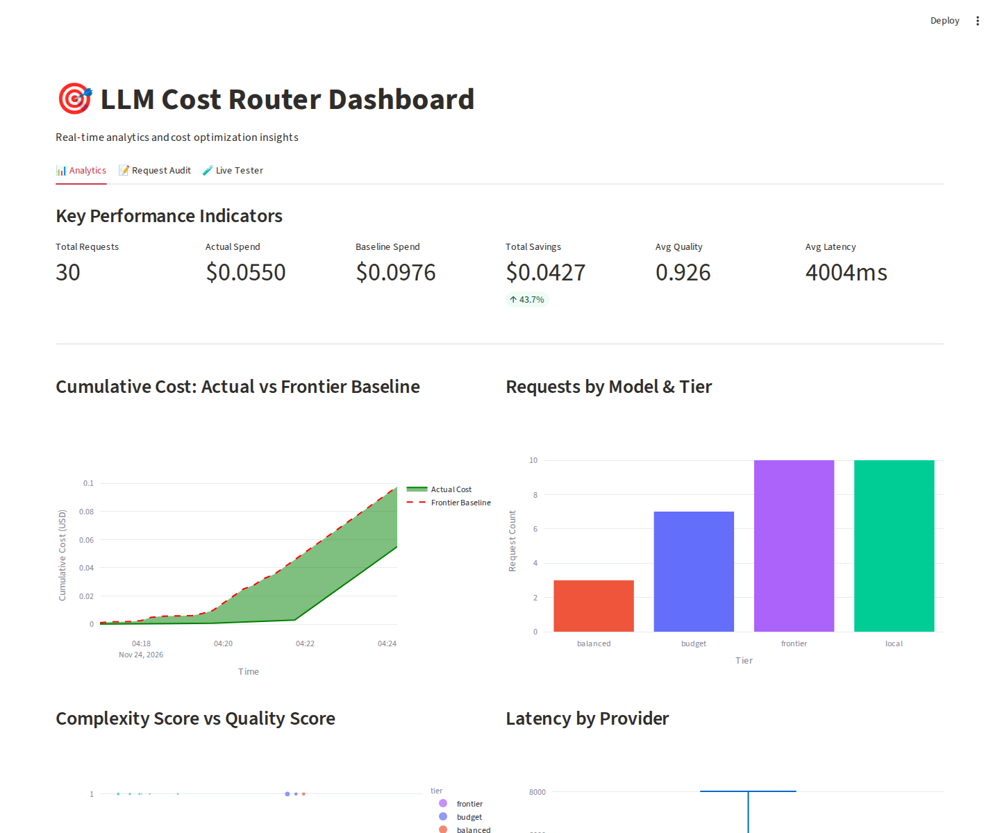

# LLM Cost Router

[](https://llm-cost-router-demo.vercel.app)

An intelligent routing layer that sits in front of multiple LLM providers, analyzes each incoming request's complexity, routes it to the cheapest model capable of handling it at acceptable quality, and continuously validates that routing decisions are correct.

## Live Demo

**[🚀 Try it now: llm-cost-router-demo.vercel.app](https://llm-cost-router-demo.vercel.app)**

The interactive demo runs the exact trained scikit-learn classifier (293 TF-IDF features + 24 structural features) in pure JavaScript with the full 30-prompt benchmark preloaded. Test routing decisions in your browser, explore analytics charts, and optionally bring your own OpenAI key for real completions.

For a full-featured local experience with auto-initialization, run `streamlit run dashboard/app.py` — zero setup required, works standalone with mock provider or with your own API keys.

## Overview

LLM Cost Router optimizes LLM usage costs by automatically selecting the most cost-effective model for each request based on prompt complexity. It features real-time quality evaluation, adaptive threshold adjustment, and comprehensive analytics.

**Key Features:**

- **Intelligent Routing**: Automatically classifies prompt complexity and routes to the optimal model
- **Multi-Provider Support**: OpenAI, Anthropic, and local Ollama models
- **Quality Verification**: Heuristic + LLM-as-judge evaluation with continuous feedback
- **Adaptive Learning**: Automatically adjusts routing thresholds based on quality metrics
- **Cost Optimization**: **43.7% lower cost at 99.2% of baseline quality** in live OpenAI benchmark (30 held-out prompts)
- **Full Observability**: SQLite audit trail, structured JSON logs, and interactive Streamlit dashboard
- **Mock Mode**: Works out-of-the-box without API keys for demos and development

## Architecture

```
┌─────────────┐
│   Request   │
└──────┬──────┘
       │
       ▼
┌─────────────────────────┐
│  Complexity Classifier  │  ◄─── scikit-learn pipeline
│  (ML-based)             │       TF-IDF + structural features
└──────┬──────────────────┘
       │
       ▼
┌─────────────────────────┐
│   Tier Selection        │  ◄─── Adaptive thresholds
│   (local/budget/        │       (adjusted by feedback loop)
│    balanced/frontier)   │
└──────┬──────────────────┘
       │
       ▼
┌─────────────────────────┐
│  Provider Selection     │  ◄─── Model catalog + fallback chains
│  + Fallback Handling    │
└──────┬──────────────────┘
       │
       ▼
┌─────────────────────────┐
│  LLM Provider Call      │  ◄─── OpenAI / Anthropic / Ollama / Mock
└──────┬──────────────────┘
       │
       ▼
┌─────────────────────────┐
│  Quality Evaluation     │  ◄─── Heuristic + LLM-as-judge
│  (Heuristic + Judge)    │
└──────┬──────────────────┘
       │
       ▼
┌─────────────────────────┐
│  Logging & Analytics    │  ◄─── SQLite + JSONL + Dashboard
│  (SQLite, JSONL, UI)    │
└──────┬──────────────────┘
       │
       ▼
┌─────────────────────────┐
│  Adaptive Feedback      │  ◄─── Rolling quality monitoring
│  (Threshold Adjustment) │       Auto-escalation on low quality
└─────────────────────────┘
```

## Benchmark Results (Live OpenAI Run)

The router was benchmarked against an always-GPT-4o baseline using 30 held-out prompts (10 simple, 10 moderate, 10 complex) distinct from the 150-prompt training set. Both configurations used `temperature=0.3` and `max_tokens=500`. Responses were evaluated with heuristics + GPT-4o LLM-as-judge (50/50 judge calls succeeded). Complex prompts routed to `gpt-4o` reused their identical baseline call.

### Overall Comparison

| Metric | Always GPT-4o Baseline | LLM Cost Router | Change |
|--------|------------------------|-----------------|--------|
| **Total Cost** | $0.0976 | $0.0550 | **-43.7%** |
| **Avg Combined Quality** | 0.933 | 0.926 | **99.2% of baseline** |
| **Avg LLM-as-Judge Score** | 0.913 | 0.897 | **98.2% of baseline** |
| **Quality Pass Rate** | 83.3% (25/30) | 86.7% (26/30) | +3.4pp |
| **Avg Latency** | 2,667 ms | 4,004 ms | +50.1% |

**Routing Distribution:**
- **20 prompts** → `gpt-4o-mini` (simple + moderate tiers)
- **10 prompts** → `gpt-4o` (complex tier, 0% incremental cost vs baseline)

### Per-Complexity-Tier Breakdown

| Tier | Count | Routed Cost | Baseline Cost | Cost Reduction | Routed Quality | Baseline Quality |
|------|-------|-------------|---------------|----------------|----------------|------------------|
| **Simple** | 10 | $0.00036 | $0.00610 | **-94.0%** | 0.970 | 0.968 |
| **Moderate** | 10 | $0.00255 | $0.03949 | **-93.5%** | 0.940 | 0.964 |
| **Complex** | 10 | $0.05204 | $0.05204 | **0%** | 0.868 | 0.868 |

### Engineering Notes

- **Cost concentration**: Complex prompts account for ~95% of routed spend (by design, since they route to `gpt-4o`)
- **Latency variance**: `gpt-4o-mini` exhibited higher latency than `gpt-4o` on moderate coding prompts during this run (likely due to network conditions or model load)
- **Quality retention**: 99.2% quality retention demonstrates effective complexity classification and tier mapping
- **Simple/moderate optimization**: 94% cost reduction on simple prompts and 93.5% on moderate prompts, with quality maintained or improved

### Reproduce

```bash
export OPENAI_API_KEY=your-key-here
python scripts/benchmark.py
```

Results are written to `docs/benchmark_results.json` with full per-prompt details.

## Complexity Classifier Performance

The ML-based complexity classifier was trained on 150 diverse prompts across three tiers (simple, moderate, complex) and evaluated on a held-out test set:

**Test Set Metrics:**
- **Accuracy**: 93.33%
- **Macro F1**: 94.41%

**Per-Class Performance:**
- **Complex**: Precision 1.000, Recall 1.000, F1 1.000
- **Moderate**: Precision 1.000, Recall 0.833, F1 0.909
- **Simple**: Precision 0.857, Recall 1.000, F1 0.923

The classifier uses a scikit-learn pipeline combining:
- **TF-IDF n-grams** (1-3 grams) for semantic content
- **Structural features**: length metrics, code/syntax markers, complexity indicators, reasoning cues, constraint counting, sentence complexity

## Quickstart

### Prerequisites

- Python 3.11+
- Docker & Docker Compose (optional, for containerized deployment)

### Local Python Setup

1. **Clone and install dependencies:**

```bash
git clone https://github.com/FAZIO11/llm-cost-router.git
cd llm-cost-router
pip install -r requirements.txt
```

2. **Train the classifier (if models/ directory is empty):**

```bash
python scripts/train_classifier.py
```

3. **Configure environment (optional for mock mode):**

```bash
cp .env.example .env
# Edit .env to set ROUTER_MODE=mock (default) or add API keys for live mode
```

4. **Start the FastAPI router:**

```bash
python -m uvicorn llm_cost_router.api.app:create_app --factory --host 0.0.0.0 --port 8000
```

5. **In another terminal, start the Streamlit dashboard:**

```bash
streamlit run dashboard/app.py --server.port=8501
```

6. **Access the services:**
   - **API**: http://localhost:8000/health
   - **Dashboard**: http://localhost:8501
   - **API Docs**: http://localhost:8000/docs

### Docker Compose Setup

```bash
docker-compose up --build
```

This starts:
- **Router API** on port 8000
- **Dashboard** on port 8501
- **Ollama** (optional, with `--profile ollama`)

## Usage Examples

### Route a Request

```bash
curl -X POST http://localhost:8000/v1/route \
  -H "Content-Type: application/json" \
  -d '{
    "prompt": "Explain how binary search works with example code",
    "run_eval": true
  }'
```

**Response:**

```json
{
  "content": "Binary search is an efficient algorithm...",
  "routing_decision": {
    "complexity_tier": "moderate",
    "complexity_score": 0.5002,
    "complexity_explanation": "moderate (high confidence): very short",
    "selected_model": "openai/gpt-4o-mini",
    "selected_tier": "budget",
    "provider": "openai",
    "fallback_used": false
  },
  "cost_usd": 0.000023,
  "input_tokens": 15,
  "output_tokens": 42,
  "latency_ms": 456,
  "frontier_baseline_cost_usd": 0.000385,
  "savings_usd": 0.000362,
  "savings_percent": 94.0,
  "eval_scores": {
    "quality_score": 0.85,
    "passed": true,
    "heuristic_score": 0.80,
    "judge_score": 0.90,
    "judge_rationale": "Response adequate for moderate complexity"
  }
}
```

### OpenAI-Compatible Endpoint

```bash
curl -X POST http://localhost:8000/v1/chat/completions \
  -H "Content-Type: application/json" \
  -d '{
    "messages": [
      {"role": "user", "content": "What is Python?"}
    ]
  }'
```

### List Available Models

```bash
curl http://localhost:8000/v1/models
```

### Get Metrics Summary

```bash
curl http://localhost:8000/v1/metrics/summary
```

## Model Catalog & Pricing

| Model                            | Provider   | Tier     | Input ($/1M) | Output ($/1M) |
|----------------------------------|------------|----------|--------------|---------------|
| `llama3.2:3b`                    | Ollama     | local    | $0.00        | $0.00         |
| `qwen2.5:7b`                     | Ollama     | local    | $0.00        | $0.00         |
| `gpt-4o-mini`                    | OpenAI     | budget   | $0.15        | $0.60         |
| `claude-3-5-haiku-latest`        | Anthropic  | balanced | $0.80        | $4.00         |
| `gpt-4o`                         | OpenAI     | frontier | $2.50        | $10.00        |
| `claude-3-5-sonnet-latest`       | Anthropic  | frontier | $3.00        | $15.00        |

**Theoretical Cost Comparison** (100K tokens in, 50K tokens out):
- **Frontier baseline** (`gpt-4o`): $0.75
- **Budget tier** (`gpt-4o-mini`): $0.045
- **Potential savings**: $0.705 (94% for a fully budget-tier workload)

*Note: Actual savings depend on prompt complexity distribution. See benchmark results above for measured performance.*

## Evaluation & Quality Verification

The router validates every response with a two-stage evaluation:

1. **Heuristic Scoring**: Fast structural checks
   - Non-emptiness, length vs complexity
   - Code blocks when code requested
   - JSON validity when JSON requested
   - Refusal/error pattern detection
   - Latency sanity checks

2. **LLM-as-Judge** (optional, in live mode):
   - Accuracy, completeness, instruction-following
   - Provides 0.0–1.0 score + brief rationale
   - In mock mode, uses deterministic rubric judge

**Combined Quality Score** = 0.4 × heuristic + 0.6 × judge

### Adaptive Feedback Loop

The router continuously monitors per-tier quality scores over a rolling window (default: 20 requests). When a tier's rolling quality drops below the target (default: 0.78), the system automatically tightens complexity thresholds to escalate more borderline prompts to higher tiers, improving quality at a modest cost increase.

## Dashboard

The Streamlit dashboard provides real-time analytics and an interactive prompt tester:



**Features:**
- **KPI Cards**: Requests, spend, savings, quality, latency
- **Charts**:
  - Cumulative cost: Actual vs Frontier Baseline
  - Requests & Savings by Model/Tier
  - Complexity vs Quality Score
  - Latency by Provider
  - Quality Pass Rate Over Time
  - Adaptive Threshold History
- **Request Audit Trail**: Filterable, downloadable CSV
- **Live Prompt Tester**: Test routing decisions in real-time

## Project Structure

```
llm-cost-router/
├── llm_cost_router/          # Main package
│   ├── api/                  # FastAPI application
│   │   └── app.py            # Endpoints & routing logic
│   ├── classifier/           # Complexity classifier
│   │   └── classifier.py     # scikit-learn pipeline
│   ├── providers/            # LLM provider adapters
│   │   ├── base.py           # Base provider interface
│   │   ├── openai_provider.py
│   │   ├── anthropic_provider.py
│   │   ├── ollama_provider.py
│   │   └── mock_provider.py  # Mock for demos
│   ├── eval/                 # Quality evaluation
│   │   ├── evaluator.py      # Heuristic + judge scoring
│   │   └── feedback.py       # Adaptive threshold adjustment
│   ├── storage/              # Data persistence
│   │   ├── database.py       # SQLite audit trail
│   │   └── jsonl_logger.py   # Structured logging
│   ├── config.py             # Configuration
│   └── pricing.py            # Model catalog & cost calculations
├── dashboard/                # Streamlit dashboard
│   └── app.py
├── scripts/                  # Utility scripts
│   ├── train_classifier.py  # Train ML classifier
│   └── seed_demo_data.py    # Seed demo database
├── data/                     # Training data
│   └── complexity_dataset.jsonl  # 150 labeled prompts
├── tests/                    # pytest suite
│   ├── test_classifier.py
│   ├── test_pricing.py
│   ├── test_providers.py
│   ├── test_evaluator.py
│   ├── test_storage.py
│   ├── test_api.py
│   └── test_feedback.py
├── models/                   # Trained ML models
├── logs/                     # Runtime logs (JSONL)
├── docs/                     # Documentation
├── Dockerfile                # API container
├── Dockerfile.dashboard      # Dashboard container
├── docker-compose.yml        # Multi-service orchestration
├── pyproject.toml
├── requirements.txt
├── .env.example
├── LICENSE                   # MIT License
└── README.md
```

## Testing

The project includes a comprehensive pytest suite with 74 tests covering all components:

```bash
pytest tests/ -v
```

**Test Coverage:**
- Complexity classifier (training, prediction, save/load)
- Pricing & cost calculations
- Provider adapters (mock, OpenAI, Anthropic, Ollama)
- Quality evaluation (heuristic, judge, pass/fail)
- Storage & database (SQLite, JSONL logging)
- FastAPI endpoints (routing, chat completions, metrics)
- Adaptive feedback loop (threshold adjustment)

**Result**: 74 passed

## Configuration

Environment variables (`.env`):

```bash
# Router mode: "mock" or "live"
ROUTER_MODE=mock

# API Keys (for live mode)
OPENAI_API_KEY=sk-...
ANTHROPIC_API_KEY=sk-ant-...

# Ollama (for local models)
OLLAMA_BASE_URL=http://localhost:11434

# LLM-as-Judge
JUDGE_PROVIDER=openai
JUDGE_MODEL=gpt-4o-mini

# Quality & Feedback
MIN_QUALITY_SCORE=0.75
ADAPTIVE_FEEDBACK_ENABLED=true

# Database & Logging
DATABASE_PATH=./data/router.db
LOG_LEVEL=INFO
JSONL_LOG_PATH=./logs/router.jsonl
```

## Seeding Demo Data

To populate the database with sample data for dashboard exploration:

```bash
# Ensure the router is running on port 8000
python scripts/seed_demo_data.py
```

This runs 60 diverse prompts through the router with evaluation enabled, creating a rich dataset for the dashboard.

## License

MIT License - Copyright (c) 2026 Fazil Sathar

See [LICENSE](LICENSE) for full text.

## Author

**Fazil Sathar**  
Email: fazilsathar200@gmail.com  
GitHub: [@FAZIO11](https://github.com/FAZIO11)

---

## Technical Implementation Highlights

- **Classifier**: Logistic regression with balanced class weights, TF-IDF (500 features, 1-3 grams) + 24 engineered structural features, trained on 150 labeled examples, 93.33% test accuracy
- **Adaptive Thresholds**: Rolling window quality monitoring with automatic escalation when quality drops below target (0.78 default), logged threshold adjustments in SQLite
- **Mock Mode**: Realistic simulation without API keys—tier-appropriate response lengths, latency ranges (200-2500ms), token estimation, and accurate cost calculation
- **Fallback Chains**: Provider/model unavailability handled gracefully with ordered fallback chains
- **OpenAI Compatibility**: `/v1/chat/completions` endpoint with routing metadata in `x_routing`
- **Full Audit Trail**: SQLite for structured queries + JSONL for event streaming
- **Docker Compose**: Multi-service setup with shared volumes for data persistence and optional Ollama profile
